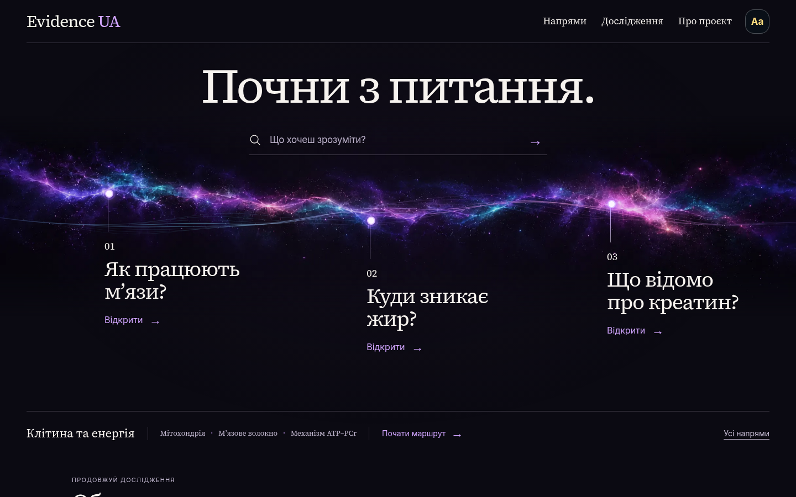

# Оновлення головної — «Спектр запитань»

Власник обрав третій космічний макет і доручив реалізацію тільки головної зі звичайним прокручуванням мишкою/пальцем, цілісною навігацією, тестами й можливістю повернення. Два графічні ескізи відкритого пошуку та меню напрямів показані власнику в розмові; вони є макетами, не браузерними скриншотами.

## Що змінено

- Головна починається пошуком і трьома реальними питаннями. Переходи й кроки маршруту беруться з чинного каталогу.
- Фіолетова спектральна хвиля має статичне зображення й окремий Canvas 2D шар, який змінюється при нормальному прокручуванні та зупиняється у спокої, поза екраном і в прихованій вкладці. Режим зменшеного руху лишає статичну композицію.
- Пошук використовує спільний контролер і базу матеріалів. Меню напрямів відкриває бічну панель; звичайні посилання працюють без JavaScript.
- Нова палітра охоплює всю головну: напрями, маршрути, бібліотеку, довідку й відгук. На інших сторінках дизайн збережено. Зміни query-версій у їх HTML потрібні для спільного header/search і не є їх редизайном.
- Старі файли збережено. Старе переписування DOM головної вимкнено для нової композиції; посібник «Як читати докази» та footer продовжують працювати з попереднім текстом.

## Збереження архітектури й змісту

Не змінено Claims, Sources, Evidence Records, числові результати, confidence, наукові схвалення та історичні fixtures. Незалежне порівняння всіх 11 наукових HTML-піддерев із базою підтвердило тотожність. Збережено hash-router, кроки маршруту energy, canonical catalog, anchors, feedback, продовження навчання та збережені матеріали.

Шапка містить усі шість канонічних посилань. На активній головній чотири другорядні пункти згорнуті оформленням; у досьє всі доступні. Посилання «Напрями» у досьє має звичайну навігацію.

## Походження візуалу та навантаження

Растровий шар хвилі створений ImageGen за дорученням власника на основі обраного макета. Це декоративний космічний спектр без тексту, медичних тверджень і молекулярних схем. Для вебу файл закодовано у WebP; текст і керування залишаються HTML. Шрифти локальні з наявними ліцензіями. Нових сторонніх runtime-залежностей немає.

Файл `dist/home-spectrum-ribbon.webp`: 50,136 байтів, 2172 × 724; SHA-256 `2864ed15ec351a790fbc23779aefb7dbc20936635984b20036a44d19e6802d4c`. Малювання має обмеження розміру/DPR та частоти; фактичну плавність на пристрої власника не заявлено.

## Перевірки

База до редагування: 93/93 тестових файлів пройшли. Нові тести renderer, motion та interactions пройшли RED→GREEN. Перший інтеграційний прогін: 92/96; чотири застарілі очікування старого CTA/cache/VM-сегмента оновлено з поясненнями, збереження наукових даних не послаблено.

Незалежний review знайшов і виправив: домашнє меню на маршруті досьє, відкладений пошук після переходу, фокус на прихованому полі, закриття панелі при кліку всередині padding, статичні стилі без JavaScript і успадкований старий grid layout. Додано регресійні перевірки. Окремо перевіряються браузерні сценарії й фактичні pixels хвилі.

Інтеграційний `npm run check` пройшов: **96/96 тестових файлів**, validation п’яти модулів, smoke **21 HTML, 97 JS, 178 локальних цілей, 293 локальні HTML-якорі**. Повторна збірка дала ідентичні hashes усіх **254 файлів dist**. Повторний незалежний review не виявив невиправлених дефектів.

Автоматичний браузерний прогін виконується документованим у `CLAUDE.md` runner на вже встановленому Chromium; браузер не встановлювався, публічний або користувацький preview не запускався. Runner сам створює тимчасовий ізольований сервер, блокує сторонні запити й закриває браузер/сервер після прогону. Це перевірка в настільному браузері з мобільними viewport і touch events, а не на фізичному телефоні власника.

Перший повний браузерний прогін виявив п’ять невдалих перевірок із 2804: три помилково очікували неіндексоване посилання `sleep.html` замість канонічного матеріалу `sleep.html#sleep-stages`, дві використовували touch-команду Chromium, що завершувалась без фактичного прокручування. Виправлено саме harness: ціль читається з каталогу; touch перевіряється довіреною послідовністю натискання/руху/відпускання. Вимоги справжнього `scrollY`, зміни пікселів Canvas, зупинки у спокої та статичного reduced motion збережені.

Перегляд справжніх скриншотів також виявив успадкований бірюзовий фон і маршрут нижче першого desktop-екрана. Ці проблеми виправлені тільки для головної; CSS cache піднятий до v2. Після виправлення **286/286 перевірок головної** пройшли на 360, 390 та 1440 px: пошук/результати, меню/фокус/Escape, реальні переходи, no-JS, звичайний wheel, touch-scroll, Canvas pixels, reduced motion і нижні блоки. Незалежний review п’ятифайлового виправлення не знайшов блокерів.

Незалежний візуальний огляд фактичних desktop/mobile скриншотів і двох панелей підтвердив відповідність обраному третьому макету: повноширинна фіолетова хвиля, три зміщені питання з прямими посиланнями, композиція 2+1 на телефоні й маршрут у першому desktop-екрані. Замість сітки однакових карток питання прив’язані до спектра; пошук і напрями узгоджені за палітрою та типографікою. Огляд не виявив візуальних блокерів і не означає перевірку унікальності всього інтернету.

Фінальний повторний `npm run check` після CSS v2 завершився з exit 0: **96/96 тестових файлів**, validation та smoke пройшли. Фінальний повний **Browser QA завершився з exit 0: 2949 перевірок на 21 сторінці × 2 viewport**, плюс окремий сценарій головної на 360 px і звичайний wheel/touch/reduced-motion; 3D-моделі фактично відрендерено **2/2**. Браузер читав окремий незмінний snapshot `dist`, щоб тести збірки не переписували файли під час завантаження. Після перебудови SHA-256 усіх **254 файлів dist** тотожні цьому перевіреному snapshot.

GitHub Actions ще не запущено: середовище відповідає `Forbidden` на HTTPS-запит до `api.github.com`, хоча Git read/push до **VlasPevochko/evidence-ua** працює. Тому PR автоматично не створено; гілка реалізації та резервна гілка збережені на GitHub. Створення PR через вебінтерфейс запустить чинні Website build and tests та Browser QA. Потрібно дочекатися обох зелених перевірок і окремого рішення власника про merge. Локальні результати не є результатами CI або публікацією.

## Фактичні скриншоти

Ці файли збережені в Git. «До» знято з `dist` базового commit `4a5be20`; «після» та інтерактивні стани — з виправленої головної під час фінального повного прогону 2949 перевірок. Це браузерні знімки, а не згенеровані макети.

| Стан | Комп’ютер | Телефон |
| --- | --- | --- |
| До змін | [1440 px](screenshots/home-spectrum/before-desktop.png) | [390 px](screenshots/home-spectrum/before-mobile.png) |
| Нова головна | [1440 px](screenshots/home-spectrum/after-desktop.png) | [390 px](screenshots/home-spectrum/after-mobile.png) |
| Відкритий пошук | [1440 px](screenshots/home-spectrum/search-desktop.png) | [390 px](screenshots/home-spectrum/search-mobile.png) |
| Вибір напряму | [1440 px](screenshots/home-spectrum/directions-desktop.png) | [390 px](screenshots/home-spectrum/directions-mobile.png) |

## Як повернути попередню головну

До merge робочий сайт продовжує показувати попередню версію. База пакета: `4a5be2032613272f12176a8fc4fd23225591f297`.

Резервна гілка **backup/home-before-spectrum-2026-10-27** збережена й відправлена на GitHub до правок. Локальний повний архів: `/workspace/scratch/evidence-ua-before-spectrum-4a5be20.tar.gz`.

Після merge цього пакета можна відкрити його PR на GitHub і використати **Revert** для нового PR повернення. Той PR проходить звичайні перевірки й після погодженого merge знову публікує стару головну. Це повертає саме пакет змін, зберігаючи незалежну подальшу роботу; reset/force-push і видалення гілок не потрібні.

Публікація нової головної потребує окремого явного «зливай» згідно CLAUDE.md. Поточний звіт не означає merge або deployment.

## Повний список змінених файлів

- `dist/atlas.html`
- `dist/cell-lab.html`
- `dist/changes.html`
- `dist/compare.html`
- `dist/directions.html`
- `dist/directions.js`
- `dist/exercises.html`
- `dist/fat-burning.html`
- `dist/fat-burning.js`
- `dist/glossary.html`
- `dist/home-spectrum-ribbon.webp`
- `dist/home-spectrum-wave.mjs`
- `dist/home-spectrum.css`
- `dist/home-spectrum.js`
- `dist/index.html`
- `dist/map.html`
- `dist/mechanisms.html`
- `dist/movement.html`
- `dist/muscle-lab.html`
- `dist/navigation-v17.js`
- `dist/nutrition-digestion.html`
- `dist/nutrition-inside.html`
- `dist/nutrition.html`
- `dist/platform-search.js`
- `dist/platform-shell.js`
- `dist/protein-meta.html`
- `dist/research.html`
- `dist/site-header.js`
- `dist/sleep.html`
- `dist/supplements.html`
- `dist/videos.html`
- `docs/HOME_SPECTRUM_REPORT.md`
- `docs/screenshots/home-spectrum/after-desktop.png`
- `docs/screenshots/home-spectrum/after-mobile.png`
- `docs/screenshots/home-spectrum/before-desktop.png`
- `docs/screenshots/home-spectrum/before-mobile.png`
- `docs/screenshots/home-spectrum/directions-desktop.png`
- `docs/screenshots/home-spectrum/directions-mobile.png`
- `docs/screenshots/home-spectrum/search-desktop.png`
- `docs/screenshots/home-spectrum/search-mobile.png`
- `docs/superpowers/plans/2026-10-27-home-spectrum.md`
- `docs/superpowers/specs/2026-10-27-home-spectrum-design.md`
- `scripts/browser-qa/run.mjs`
- `scripts/build-platform.mjs`
- `src/platform/home-spectrum.mjs`
- `src/platform/search.mjs`
- `src/platform/site-header.mjs`
- `tests/evidence.test.mjs`
- `tests/exercise-library.test.mjs`
- `tests/fat-burning.test.mjs`
- `tests/food-path.test.mjs`
- `tests/home-about.test.mjs`
- `tests/home-entry.test.mjs`
- `tests/home-geo-hero.test.mjs`
- `tests/home-mobile-menu.test.mjs`
- `tests/home-spectrum-interactions.test.mjs`
- `tests/home-spectrum-wave.test.mjs`
- `tests/home-spectrum.test.mjs`
- `tests/navigation-flow.test.mjs`
- `tests/nutrition-architecture.test.mjs`
- `tests/platform.test.mjs`
- `tests/review-corrections.test.mjs`
- `tests/site-search.test.mjs`
